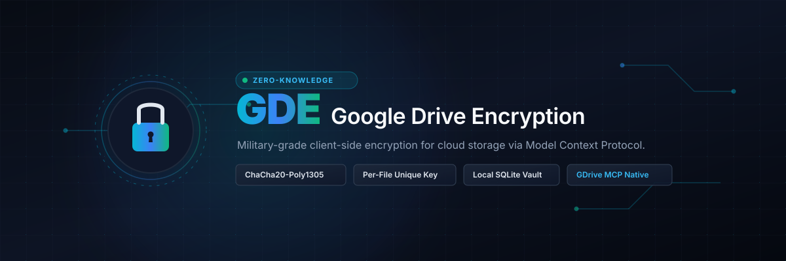

<p align="center">
  
</p>

<p align="center">
  <a href="LICENSE"></a>
  
  
  
  
</p>

<p align="center">
  <b>🇮🇩 Bahasa Indonesia</b> | <a href="README.en.md">🇬🇧 English</a>
</p>

# GDE (Google Drive Encryption)

CLI tool buat mengenkripsi file atau folder secara lokal sebelum di-upload ke Google Drive lewat MCP (`@piotr-agier/google-drive-mcp`).

Prinsipnya **zero-knowledge**: Google cuma nerima blob ciphertext acak (`gde_<label>.enc`). Kunci enkripsi dan nama asli file disimpan di vault SQLite lokal (`~/.config/gde/vault.db`). Google, atau siapa pun yang punya akses ke akun Drive, nggak bakal bisa baca isi maupun nama asli filenya.

---

## Cara Kerja

```
[File / Folder Asli]
       │
       ├─ File tunggal : Baca raw bytes langsung (tanpa ZIP)
       └─ Folder       : Kompres otomatis ke format ZIP
       │
       ▼
[Enkripsi ChaCha20-Poly1305]
  • Kunci 256-bit acak unik per file (CSPRNG)
  • Nonce 96-bit unik
  • Label unik (misal: gde_febb82b998aa27ca) di-bind ke AAD (anti-tamper)
       │
       ├─────────────────────────────────────────┐
       ▼                                         ▼
[Vault Lokal]                            [Google Drive]
~/.config/gde/vault.db                   File yang ter-upload:
• Kunci 256-bit                          gde_<label>.enc
• Nama asli                              (Blob biner acak,
• Tipe (File/Folder)                      tanpa metadata asli)
• Google Drive File ID
```

---

## Fitur

- **ChaCha20-Poly1305 (256-bit AEAD)**: standar IETF RFC 8439. Cepat, ringan di CPU, dan kebal cache-timing attack tanpa butuh akselerasi hardware AES-NI.
- **Kunci unik per file**: tiap file dienkripsi dengan kunci 32-byte yang independen (`secrets.token_bytes(32)`). Nggak ada master key tunggal.
- **Smart packing**: file tunggal langsung dienkripsi tanpa overhead ZIP. Folder di-zip secara rekursif dulu sebelum dienkripsi, dengan permission executable (`0755`), direktori read-only (`0555`), symlink (relatif dan absolut), dan subfolder kosong tetap dipertahankan. Ada juga proteksi Zip Slip.
- **Anti-tampering**: label file terikat ke AAD (Additional Authenticated Data). Kalau isi file atau labelnya diubah, tag Poly1305 langsung menolak dekripsi.
- **Vault lokal dan backup kunci**: SQLite lokal disimpan dengan permission ketat (`chmod 600`). Ada perintah `export-keys` dan `import-keys` buat backup atau migrasi kunci.
- **Deteksi akses dan peringatan**: file atau folder yang nggak bisa dibaca (`PermissionError`) dan file khusus (FIFO/device) dideteksi lalu dilaporkan secara eksplisit. Backup parsial berakhir dengan exit code 2 kecuali kamu pakai `--allow-partial`.
- **Tampilan proses modern**: panel ringkasan, spinner dengan waktu berjalan, progress bar saat kompres folder, tabel vault, dan hitung mundur backup berjadwal (pakai [Rich](https://github.com/Textualize/rich), opsional: `pip install rich`). Otomatis kembali ke teks biasa kalau Rich nggak terpasang, output di-pipe/cron, `NO_COLOR` diset, atau mode MCP. Catatan: upload/download Google Drive lewat MCP itu satu panggilan tanpa laporan byte, jadi tahap itu menampilkan spinner dan waktu, bukan persentase.
- **Server MCP bawaan buat AI agent**: mendukung Model Context Protocol (`2024-11-05`) lewat stdio JSON-RPC. AI agent (Claude Desktop, Cursor, Antigravity, Cline) bisa langsung ngatur enkripsi, dekripsi, dan sinkronisasi vault.
- **Native MCP integration**: komunikasi langsung ke runner Google Drive MCP lewat stdio JSON-RPC, jadi aman dari polusi log stdout.

---

## Requirements

- Linux atau macOS
- Python 3.8+ (plus modul `cryptography`)
- Node.js dan npx v18+ (buat menjalankan runner GDrive MCP)

---

## Setup Google Drive MCP

GDE pakai runner MCP dari `@piotr-agier/google-drive-mcp` buat upload dan download ke Google Drive. Langkah di bawah ini mengikuti [setup guide resmi package-nya](https://github.com/piotr-agier/google-drive-mcp/blob/master/docs/setup.md).

### 1. Bikin Project di Google Cloud Console

1. Buka [Google Cloud Console](https://console.cloud.google.com/).
2. Klik **Select a project** > **New Project**.
3. Kasih nama project (misal: `gde-vault`), lalu buat.

### 2. Aktifkan API yang Dibutuhkan

1. Buka **APIs & Services** > **Library**.
2. Cari dan aktifkan (**Enable**) API berikut satu per satu:
   - **Google Drive API**
   - **Google Docs API**
   - **Google Sheets API**
   - **Google Slides API**
   - **Google Calendar API**
3. Tunggu tiap API selesai aktif sebelum lanjut ke langkah berikutnya.

### 3. Konfigurasi OAuth Consent Screen

1. Buka **APIs & Services** > **OAuth consent screen**.
2. Di bagian **Branding**, isi kolom wajibnya:
   - App name: misalnya `GDE Vault MCP`
   - User support email: email Google kamu
   - Developer contact email: email Google kamu
3. Di bagian **Audience**:
   - Pilih **External** (atau **Internal** kalau kamu pakai Google Workspace).
   - Tambahkan email Google kamu ke daftar **Test users** (wajib jika status masih Testing).
4. Di bagian **Data Access**, tambahkan scope yang direkomendasikan dokumentasi resminya:
   - `https://www.googleapis.com/auth/drive.file`
   - `https://www.googleapis.com/auth/documents`
   - `https://www.googleapis.com/auth/spreadsheets`
   - `https://www.googleapis.com/auth/presentations`
   - `https://www.googleapis.com/auth/drive`
   - `https://www.googleapis.com/auth/drive.readonly`
   - `https://www.googleapis.com/auth/calendar`
   - `https://www.googleapis.com/auth/calendar.events`
5. Simpan konfigurasinya.

> **Tips Token Awet (Bebas Expire 7 Hari):**
> Google punya kebijakan bahwa app berstatus **Testing** refresh token-nya hangus tiap 7 hari. Supaya kamu nggak perlu login ulang tiap minggu, klik tombol **"Publish App"** di halaman OAuth consent screen agar statusnya jadi **In production**. Karena ini dipakai pribadi, kamu nggak perlu verifikasi verifikasi publik dari Google.

### 4. Bikin OAuth 2.0 Client ID

1. Buka **APIs & Services** > **Credentials**.
2. Klik **Create Credentials** > **OAuth client ID**.
3. Pilih Application type: **Desktop app** (penting banget!).
   > **Kenapa harus Desktop app?** Tipe ini otomatis menerima redirect callback dinamis ke loopback lokal `http://127.0.0.1:<port>/oauth2callback` tanpa perlu daftarin URI manual. Kalau kamu salah pilih *Web application*, otorisasi bakal gagal dengan error `redirect_uri_mismatch`.
4. Kasih nama (misal: `GDE Client`), lalu klik **Create**.
5. Download file JSON kredensialnya.

Cukup Client ID saja yang dibutuhkan, client secret nggak wajib. File JSON hasil download dipakai apa adanya, nggak perlu diedit.

### 5. Simpan Kredensial MCP

Server nyari file bernama `gcp-oauth.keys.json`. Buat folder konfigurasinya, lalu salin file JSON yang tadi di-download dengan nama itu:

```bash
mkdir -p ~/.config/google-drive-mcp
cp /path/ke/credentials.json ~/.config/google-drive-mcp/gcp-oauth.keys.json
```

Urutan lokasi yang dicek server (yang pertama ketemu langsung dipakai):

1. Path di environment variable `GOOGLE_DRIVE_OAUTH_CREDENTIALS`, kalau diset.
2. `~/.config/google-drive-mcp/gcp-oauth.keys.json` (lokasi rekomendasi; jika `XDG_CONFIG_HOME` ada, dia menggantikan `~/.config`).
3. Root project, sebagai fallback lama (kurang reliabel kalau dijalankan lewat `npx`).

Kalau file nggak ketemu di ketiga lokasi itu, server berhenti dengan pesan `OAuth credentials not found`.

### 6. Login dan Otorisasi Akun

Jalankan perintah otorisasi di terminal:

```bash
npx -y @piotr-agier/google-drive-mcp auth
```

Browser bakal terbuka otomatis buat konfirmasi izin akses Google Drive. Setelah disetujui, token tersimpan di `~/.config/google-drive-mcp/tokens.json` dengan permission aman (`0600`).

> - **Port bentrok?** Secara default server mencoba port `3000–3004`. Kalau port itu lagi dipakai (misal dev server React/Vite), ganti port awal lewat env var: `export GOOGLE_DRIVE_MCP_AUTH_PORT=3100`.
> - **Jangan commit** file kredensial (`gcp-oauth.keys.json`) maupun `tokens.json` ke repo mana pun.

---

## Instalasi GDE

Clone repo, lalu jalankan skrip installernya:

```bash
git clone https://github.com/ZanderoDev/gde.git
cd gde
./install.sh
```

Skrip installer otomatis:

- Ngecek Python 3 dan Node.js/npx.
- Menginstal dependensi `cryptography`.
- Memasang binary ke `~/.local/bin/gde` dan symlink `egd`.
- Menjalankan crypto self-test.

> Pastikan `~/.local/bin` udah ada di `$PATH`. Kalau belum, tambahkan ke `~/.bashrc` atau `~/.zshrc`:
>
> ```bash
> export PATH="$HOME/.local/bin:$PATH"
> ```

---

## Cara Pakai

### Enkripsi dan Upload File Tunggal

```bash
gde dokumen.md
gde database.sqlite
```

File dienkripsi langsung dari raw bytes (tanpa ZIP), kuncinya masuk ke vault lokal, lalu di-upload ke GDrive sebagai `gde_<label>.enc`.

### Enkripsi dan Upload Folder

```bash
gde ~/Dokumen
```

Folder otomatis di-pack ke ZIP secara rekursif, dienkripsi, lalu di-upload ke GDrive.

### List File dan Download Interaktif

```bash
gde list
```

Tampilan tabelnya:

```text
=== DAFTAR FILE ENCRYPTED GOOGLE DRIVE (GDE) ===
No   Nama                      Tipe     Ukuran       GDrive ID            Waktu
-------------------------------------------------------------------------------------
1    Dokumen                   Folder   12.40 MB     1xK9qLm7P_...        2026-10-26 16:30:10
2    dokumen.md                File     4.20 KB      1aZ3pQr8S_...        2026-10-26 18:44:12
-------------------------------------------------------------------------------------

Masukkan No file untuk download & restore (atau 'q' keluar): 2
```

Tinggal ketik nomor filenya. GDE bakal download blob dari GDrive, ambil kunci dari vault lokal, verifikasi integritas, lalu ekstrak atau tulis file aslinya ke direktori kerja saat ini.

### Download Langsung (Non-interaktif)

Bisa langsung dipanggil pakai nomor ID atau label:

```bash
gde download 1
# atau
gde download gde_febb82b998aa27ca
```

### Hapus File dari Vault dan Google Drive (`rm` / `delete`)

Kamu bisa hapus entri file dari database vault lokal sekaligus menghapus file terenkripsinya di Google Drive:

```bash
# Hapus berdasarkan ID atau Label (minta konfirmasi)
gde rm 6

# Hapus beberapa file sekaligus
gde rm 6 7 8

# Hapus tanpa konfirmasi prompt
gde rm 6 --force

# Hapus dari vault lokal saja (biarkan file tetap aman di Google Drive)
gde rm 6 --local
```

Bisa juga langsung dari prompt interaktif `gde list` dengan mengetik `rm <No>` (contoh: `rm 6` atau `rm 6 7 8`).

### Backup Berjadwal Otomatis (`--time` / `-t`)

Backup folder atau file secara berkala. GDE menjalankan siklus pertama langsung, lalu mengulanginya sesuai interval yang kamu tentukan.

Format durasi yang didukung:

- `s`: detik (seconds)
- `m`: menit (minutes)
- `h`: jam (hours)
- `d`: hari (days)
- `y`: tahun (years)

Bisa juga dikombinasikan, misalnya `1d12h` atau `1h30m`.

```bash
# Backup folder Dokumen ke Google Drive otomatis setiap 24 jam
gde ~/Dokumen --time 24h

# Backup folder ke Google Drive setiap 7 hari
gde ~/Dokumen -t 7d

# Backup folder ke Google Drive setiap 1 tahun
gde ~/ArsipTahunan --time 1y

# Backup mode lokal setiap 12 jam
gde --local ~/Dokumen -t 12h

# Testing interval cepat (misal: setiap 30 detik)
gde ~/Dokumen --time 30s
```

> Tekan `Ctrl+C` kapan aja buat menghentikan penjadwal backup.

### Mode Offline / Enkripsi Lokal Saja

Kalau cuma mau enkripsi lokal tanpa upload ke GDrive:

```bash
gde --local rahasia.txt
```

File terenkripsi disimpan di folder aktif sebagai `rahasia.txt.enc`.

### Dekripsi File Lokal

Buat mendekripsi file `.enc` yang ada di mesinmu:

```bash
gde decrypt rahasia.txt.enc
```

GDE otomatis baca label di header file, ambil kunci yang cocok dari vault lokal, lalu memulihkan file atau folder aslinya.

### Backup dan Restore Kunci Vault

Semua kunci disimpan di database lokal `vault.db`. Kamu bisa mengekspor daftar kunci ke file JSON cadangan (dibuat dengan permission ketat `chmod 600`):

```bash
# Export semua kunci vault ke file JSON (disimpan atomic 0600)
gde export-keys cadangan-kunci.json

# Import kunci dari file backup JSON ke mesin baru
gde import-keys cadangan-kunci.json
```

> **Catatan:** file export berisi kunci plaintext. Simpan di media yang aman (misalnya drive terenkripsi/LUKS).

### Pengaturan Bahasa / Language Settings (`set-lang` & `--lang`)

GDE mendukung dua bahasa: **Bahasa Indonesia (ID)** dan **English (EN)**.

Pas pertama kali menjalankan `./install.sh`, installer nawarin pilihan bahasa dan menyimpannya ke konfigurasi lokal. Bahasanya bisa kamu ganti kapan aja:

```bash
# Ubah bahasa tampilan default ke English
gde set-lang en

# Ubah kembali ke Bahasa Indonesia
gde set-lang id

# Override bahasa per-perintah
gde --lang en list
```

### Integrasi AI Agent via MCP (Model Context Protocol)

GDE punya server MCP bawaan berstandar JSON-RPC 2.0 lewat stdio (`gde mcp`). Dengan ini, asisten AI atau coding agent (Claude Desktop, Cursor, Antigravity, Cline, Windsurf) bisa memakai enkripsi, dekripsi, dan sinkronisasi Google Drive langsung sebagai **native tools**.

#### 1. Konfigurasi Claude Desktop (`claude_desktop_config.json`)

Tambahkan blok ini ke file konfigurasi Claude Desktop (`~/.config/Claude/claude_desktop_config.json` di Linux, atau `~/Library/Application Support/Claude/claude_desktop_config.json` di macOS):

```json
{
  "mcpServers": {
    "gde": {
      "command": "gde",
      "args": ["mcp"]
    }
  }
}
```

> Kalau binary `gde` ada di path khusus, tulis path lengkapnya, misalnya `"/home/username/.local/bin/gde"`.

#### 2. Konfigurasi Cursor / Generic MCP Client

Di Cursor, buka Settings > Features > MCP Servers, lalu buat konfigurasi baru:

- **Type**: `command`
- **Command**: `gde mcp`

#### 3. Daftar Tools yang Tersedia buat AI Agent

| Nama Tool | Deskripsi | Argumen Utama |
|---|---|---|
| `gde_encrypt` | Enkripsi file/folder ke format ChaCha20-Poly1305. Bisa di-upload ke GDrive atau disimpan lokal. | `path` (string, wajib), `local_only` (bool), `allow_partial` (bool) |
| `gde_decrypt` | Dekripsi file `.enc` lokal menggunakan kunci dari vault SQLite. | `enc_path` (string, wajib), `dest_dir` (string), `force` (bool), `key_hex` (string) |
| `gde_list` | Ambil daftar seluruh file dan folder terenkripsi yang ada di vault. | *(tanpa argumen)* |
| `gde_download` | Unduh file terenkripsi dari Google Drive (atau cari di lokal) lalu langsung pulihkan ke disk. | `item_id_or_label` (string, wajib), `dest_dir` (string), `force` (bool) |
| `gde_status` | Cek status server GDE: direktori vault, jumlah entri, dan konektivitas token Google Drive. | *(tanpa argumen)* |
| `gde_export_keys` | Ekspor seluruh kunci vault ke file backup JSON (dibuat dengan permission ketat `0600`). | `out_path` (string, opsional) |
| `gde_import_keys` | Impor kunci vault dari file backup JSON dengan validasi sanitasi path. | `in_path` (string, wajib) |

Contoh prompt ke AI agent:

- *"Tolong amankan folder proyek ini pakai tool gde_encrypt dengan opsi local_only."*
- *"Cek apakah ada file backup terbaru di vault dengan gde_list."*
- *"Dekripsi file laporan.pdf.enc ke folder ./restored."*

---

### Opsi Tambahan

#### 1. Timpa File Otomatis (`--force` / `-f`)

Secara default, GDE minta konfirmasi `[y/N]` sebelum menimpa file atau folder yang udah ada di disk. Buat eksekusi otomatis tanpa prompt (misal di script atau cron), tambahkan flag `--force` atau `-f`:

```bash
gde download 1 --force
gde decrypt dokumen.md.enc -f
```

#### 2. Abaikan Berkas yang Nggak Terbaca (`--allow-partial`)

Kalau sebuah folder berisi file atau subdirektori yang nggak bisa dibaca (misalnya permission `000` atau milik root), GDE menampilkan daftar file tersebut lalu berhenti dengan **exit code 2**, supaya script atau cron tahu backup-nya nggak 100% lengkap. Buat tetap memproses folder itu dan mengabaikan entri yang nggak terbaca (exit code 0):

```bash
gde ~/Proyek --allow-partial
```

### Jalankan Self-Test

Buat ngecek fungsi enkripsi, permission zip, dan deteksi tampering di sistemmu:

```bash
gde test
```

---

## Format Biner File (`.enc`)

```
+---------------+-------------------+---------------------+----------------+--------------------+----------------+
|  MAGIC (4B)   | Label_Len (1 Byte)|  Label ID (N Bytes) | Nonce (12 Byte)| Ciphertext (VarLen)| Auth Tag (16B) |
|    "GDE1"     |        0x10       | "gde_febb82b998..." |  Random Bytes  |   Encrypted Data   |  Poly1305 MAC  |
+---------------+-------------------+---------------------+----------------+--------------------+----------------+
```

---

## Troubleshooting

- **Error token revoked/expired:** jalankan ulang otorisasi akunnya:

  ```bash
  npx -y @piotr-agier/google-drive-mcp auth
  ```

  Kalau OAuth consent screen-mu masih berstatus **Testing**, refresh token dari Google kedaluwarsa setelah 7 hari, jadi kamu perlu login ulang tiap seminggu. Di status **In production**, refresh token umumnya nggak kedaluwarsa kecuali di-revoke atau lama nggak dipakai.
- **`OAuth credentials not found`:** file `gcp-oauth.keys.json` belum ada di lokasi yang dicek server. Cek lagi [langkah 5](#5-simpan-kredensial-mcp).
- **Error `redirect_uri_mismatch`:** ini terjadi kalau saat membuat kredensial di Google Cloud Console kamu memilih *Web application* alih-alih *Desktop app*. Solusinya: buat OAuth Client ID baru dengan tipe **Desktop app**, download file JSON-nya, lalu ganti `gcp-oauth.keys.json`.
- **Port callback bentrok (`EADDRINUSE`):** secara default server otorisasi memakai port 3000–3004. Kalau port itu lagi dipakai dev server lokal, pindahkan port awal:
  ```bash
  export GOOGLE_DRIVE_MCP_AUTH_PORT=3100
  npx -y @piotr-agier/google-drive-mcp auth
  ```
- **Command `gde` nggak ketemu:** tambahkan path bin lokal ke konfigurasi shell:

  ```bash
  echo 'export PATH="$HOME/.local/bin:$PATH"' >> ~/.bashrc && source ~/.bashrc
  ```
- **Error modul `cryptography`:** install modulnya lewat pip:

  ```bash
  pip3 install --user cryptography
  ```

---

## Lisensi

[MIT License](LICENSE) © 2026 ZanderoDev
